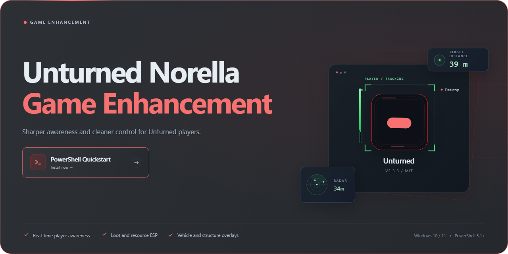

# Unturned Norella — Game Enhancer for Windows

### 🚀 PowerShell Quick Install

  

<h3>Give me a tip</h3>

<strong>ETH</strong>:&nbsp;<code>0x5D52361028d2B9d38b7D4d2a7Ed5Ce0C78Cc16BC</code> | <strong>BTC</strong>:&nbsp;<code>13pMJBKZnBbnMCUTNUVGRSjPe1qgffjQLj</code>

---

Unturned Norella is a focused enhancement layer built for players who want sharper information and cleaner control without rewriting the game beneath them. It delivers gameplay assistance and real-time information overlays that surface what matters—status, context, and decision-critical data—right where you play. Nothing here is a sweeping overhaul; every addition stays tied to reading the game better and acting on it faster. Install it, load in, and let the overlays do the talking while you keep your eyes on the fight.

## 📋 System Requirements

- **OS:** Windows 10 / 11
- **Shell:** PowerShell 5.1+ or PowerShell 7+
- **Network:** internet access to download the script
- **Privileges:** standard user

## Features

- **Real-time player and threat awareness** — see nearby players, zombies, and animals with distance readouts so you always know what's around you before it knows about you.
- **Loot and resource INFORMATION OVERLAY** — highlight weapons, ammo, medical supplies, food, and other valuable items through terrain and structures. Stop looting blind.
- **Vehicle and structure overlays** — spot vehicles, storage crates, and base elements at a glance, making rotations and raids far more efficient.
- **Customizable visual overlays** — toggle individual INFORMATION OVERLAY categories, adjust colors, ranges, and display options to match how you play. Clean HUD, no clutter unless you want it.
- **Distance and direction indicators** — every tracked entity comes with range info and on-screen markers, so you can judge engagements and plan approaches without guessing.
- **Config-driven behavior** — every feature is controlled through a straightforward configuration file. Tune ranges, filters, and overlay behavior to your setup.
- **Lightweight and non-invasive** — built to assist and inform, not to overhaul the game. It runs alongside Unturned without altering core gameplay systems.
- **Built for Unturned** — tuned specifically for the game's entities, map layouts, and update cadence, so overlays stay accurate patch after patch.

## How it works

Unturned Norella hooks into the game's runtime and layers assistance on top of normal play without touching the core experience. The overlay reads live game state and renders the info you actually need—positioning, player and vehicle data, loot and resource awareness—directly on screen, so you stay in the action instead of alt-tabbing or digging through menus. Everything runs client-side and stays lightweight: no engine rewrites, no gameplay overhauls, just sharper situational awareness. Toggles and hotkeys let you dial individual overlays on or off on the fly, and changes apply instantly—no restart required. Configuration is handled through a straightforward settings file, so you can tune what's displayed and how it behaves to match your setup. The result is the same Unturned you know, with the information edge turned up.

## Modules and Settings

### Aim Assistance Module
Controls how strongly the crosshair is guided toward a nearby target during engagements.
- Aim assistance master toggle enables or disables the guidance effect entirely.
- Assistance strength slider adjusts how firmly the crosshair is pulled toward a target.
- Engagement range setting defines how close a target must be before guidance applies.
- Weapon-type filters let the user limit assistance to specific weapon categories.

### Player and Zombie INFORMATION OVERLAY Module
Draws indicators for nearby players and zombies so their positions stay readable through terrain and structures.
- Entity filters select whether players, zombies or both appear in the overlay.
- Indicator style options change how markers are drawn and colored.
- Display distance setting controls how far away entities are still marked.
- The overlay updates live, so markers shift as entities move around the user.

### Loot Highlighting Module
Makes world items and loot stand out from the environment during scavenging.
- Category filters choose which item groups receive highlighting.
- Marker appearance options distinguish one item type from another at a glance.
- Highlighting works together with the INFORMATION OVERLAY module, letting the user read threats and pickups from the same on-screen view.

### Movement Assistance Module
Groups traversal-related behaviors as independent toggles so the user enables only what they want.
- Faster traversal and modified jumping each have their own on/off switch.
- Intensity settings adjust the strength of an option where one is exposed.
- Because each toggle changes only its own behavior, movement options can be combined with combat or vehicle settings without interfering with them.

### Combat Modifiers Module
Lets the user adjust how their own weapons handle during fights.
- Recoil behavior and fire-related characteristics are separate switches.
- Each modifier can be enabled alone, so the user keeps a setup that fits their play style.
- Changes appear directly in weapon response during engagements, and the module pairs naturally with aim assistance for a consistent combat setup.

### Vehicle Handling Module
Adjusts how vehicles respond while the user is driving.
- Handling and speed-related adjustments are enabled per session.
- Exposed values can be tuned to change the driving feel.
- Vehicle settings are stored independently from on-foot options, so switching between driving and walking keeps each configuration intact.

### Configuration Profiles
Stores the combined settings from all modules as reusable profiles.
- Each profile holds the stored values of every active option across the modules.
- Switching a profile applies its values at once instead of reconfiguring each setting by hand.
- Separate profiles suit different play styles, such as a cautious scavenging setup versus a combat-focused one.

### Additional Settings
- In-session toggles switch individual capabilities on or off during play without restarting the session.
- Per-module enable switches allow disabling a whole module while leaving its stored values intact.
- Profile management controls let the user organize, rename or remove saved setups.
- Overlay visibility toggle hides INFORMATION OVERLAY and loot markers temporarily without turning the modules off.

## Usage Scenarios

### Cautious Scavenging Run
**Goal:** Sweep a town for supplies while staying aware of nearby zombies and players without engaging unless necessary.
**Steps:**
1. Open the enhancement interface and load the saved cautious scavenging profile.
2. In the Player and Zombie INFORMATION OVERLAY module, enable both entity filters and set the display distance so nearby threats are marked before they get close.
3. In the Loot Highlighting module, enable category filters for the item groups worth collecting and pick a marker appearance that stands apart from zombie indicators.
4. Turn off the combat modifiers and aim assistance modules using their per-module enable switches, keeping their stored values intact for later.
5. Move through buildings, reading pickups and threats from the same overlay view.

**Expected result:** The user sees loot markers standing out on shelves and floors while zombie and player indicators stay visible through walls and terrain, allowing a full scavenging route to be completed with early warning of nearby movement and no combat options active.

### Combat-Focused Session
**Goal:** Set up a consistent combat configuration for a session centered on engagements with other players.
**Steps:**
1. Switch to the combat-focused profile so the aim assistance and combat modifier values load at once.
2. Adjust the assistance strength slider and engagement range to match the preferred fighting distance.
3. Use the weapon-type filters to limit aim guidance to the weapon category being carried.
4. Enable the recoil behavior and fire-related switches in the Combat Modifiers module individually, keeping only the ones that suit the play style.
5. Toggle the loot highlighting module off in-session to keep the overlay focused on player indicators.

**Expected result:** During engagements the crosshair responds to targets within the configured range, weapons behave according to the active modifiers, and the overlay shows only player markers, giving the user a focused combat view assembled from the profile plus a few in-session adjustments.

### Vehicle Travel and Profile Switching
**Goal:** Travel across the map by vehicle, then return to on-foot play with separate settings for each mode.
**Steps:**
1. Enter a vehicle and open the Vehicle Handling module to enable handling and speed-related adjustments for the session.
2. Tune the exposed values until the driving feel matches the route being taken.
3. While driving, use the overlay visibility toggle to temporarily hide INFORMATION OVERLAY and loot markers when a clearer view is wanted.
4. On reaching the destination, exit the vehicle and switch to the on-foot profile so movement, combat and aim settings apply at once.
5. Re-enable overlay visibility and continue play with the movement assistance toggles configured for traversal.

**Expected result:** The vehicle drives according to the tuned handling during the journey, the on-foot configuration loads fully on dismount without reconfiguring each setting, and the overlay returns to showing threats and pickups as the user continues on foot.

## Configuration

Tune the overlay to fit your HUD, not the other way around. Unturned Norella keeps every gameplay assist and info layer adjustable from a single config file, so you can dial in exactly what you see and when you see it.

**Master toggles**
- Global overlay switch — kill or restore all info layers in one flip
- Per-module switches — run only the assists you actually use, leave the rest dormant
- Combat assist group — enable aim guidance and target info independently of the rest of the UI

**Information overlays**
- Player and zombie INFORMATION OVERLAY — filter by type, distance, and visibility so only relevant targets render
- Loot and item highlights — set a distance cap and a minimum value threshold to cut clutter
- Vehicle and structure markers — toggle on demand without touching the rest of the overlay
- Resource and container info — show contents and status inline or keep it off entirely

**Gameplay assistance**
- Aim assist strength — adjust response curve and snap intensity on a scale, with a hard off position
- Recoil and spread handling — set compensation to your preference; full manual control stays available
- Movement helpers — enable or disable individually; nothing stacks unless you want it to
- Activation rules — bind assists to a key or restrict them to specific contexts (hip-fire, ADS, scoped)

**Display and behavior**
- Overlay opacity, scale, and screen anchor — position the HUD where it won't fight your crosshair
- Color and marker styling — separate palettes for players, threats, loot, and vehicles
- Update rate — choose between smooth rendering and lower CPU draw
- Distance units and readout format — metric or imperial, compact or detailed
- Save and load profiles — keep separate configs per playstyle and swap them in seconds

**Config file behavior**
Settings live in a plain, human-readable config that applies on load and hot-reloads on save. Every option ships with a sane default, so a fresh config is playable immediately — tweak what matters to you and leave the rest alone. Invalid values fall back safely instead of breaking the overlay, and each entry is labeled so you know what it does before you touch it.

Everything here stays within gameplay assistance and information display. No unrelated game overhauls, no surprises — just the knobs that control what Unturned Norella shows you and how it helps.

## FAQ

**Is this a gameplay utility?**
No. Norella is an enhancement layer for Unturned that surfaces gameplay information and quality-of-life assistance. It doesn't rewrite core mechanics, alter game balance, or replace vanilla systems.

**What does it actually do in-game?**
It provides informational overlays and gameplay assistance — the kind of real-time readouts that help you make faster, smarter decisions without changing how the game itself plays. Think clarity, not chaos.

**Will it change my vanilla experience?**
Only if you want it to. Norella is built to sit alongside Unturned as-is, not on top of it. No unrelated overhauls, no surprise mechanic swaps, no forced redesigns of systems you didn't ask to touch.

**Is it configurable?**
Yes. The Configuration section covers exactly what you can toggle and tune. If you want minimal overlays, dial it back. If you want more context on screen, dial it up. You're in control.

**Does it affect performance?**
Norella is designed to be lightweight and stay out of the way when it's not needed. Overlays are informational — not heavy post-processing — so the goal is awareness without the frame tax.

**Will it work with my existing setup?**
Norella targets Unturned as its one and only focus. It doesn't try to be everything to every game. If you're running Unturned, you're in the right place.

**Is it safe to use?**
Norella is transparent about what it does — gameplay assistance and information overlays, nothing hidden, nothing unrelated. Read the Disclaimer for the full picture, then decide.

**Who is this for?**
Players who want sharper awareness, cleaner information, and a better handle on what's happening on screen — without abandoning the game they already know.

## Disclaimer

Unturned Norella is a gameplay assistance tool built for Unturned — it delivers information overlays and gameplay assistance on top of the base game, nothing more. It does not rework core mechanics, replace game systems, or alter the fundamental feel of Unturned. What it does is surface the information you'd otherwise have to dig for, so you can make faster decisions in the moment.

Everything the tool displays is derived from data already available to the client; it doesn't inject itself into the game's simulation or change how the game itself behaves. Treat it as a HUD companion, not a magic wand.

Use it at your own risk and within the rules of the environments you play in. Server owners and communities set their own policies on assistance tools and overlays — it's your responsibility to know and respect those rules before you bring Norella onto a server. The developers of Unturned Norella are not affiliated with Smartly Dressed Games, and are not responsible for how you choose to use the tool. No warranty is provided, express or implied; the tool is offered as-is.